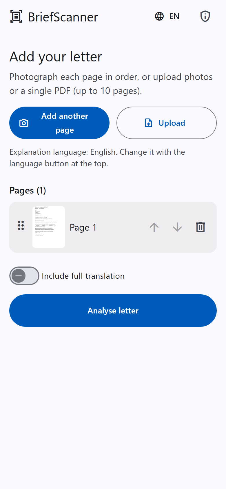
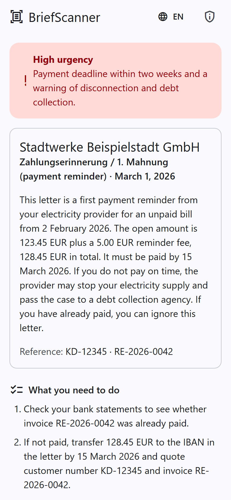
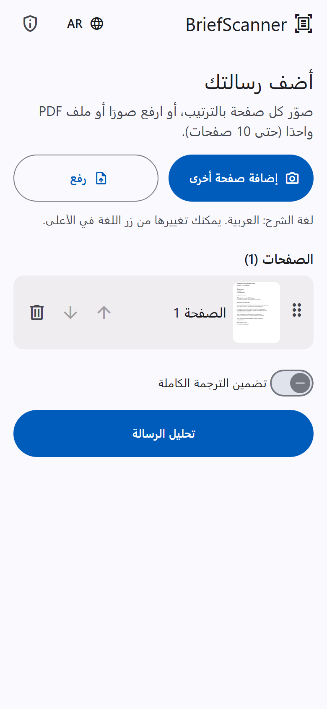

# BriefScanner

**Understand official German letters in your own language.** Photograph or upload a letter (Finanzamt,
Krankenkasse, Jobcenter, landlord, Mahnung, ...) and get a plain-language explanation: who sent it, what it
means, how urgent it is, what you must pay or do, and by when.

Mobile-first, installable as an app on Android and iOS (PWA), and private by design: nothing is stored.

<p align="center">
  
  
  
</p>

<sub>Screenshots use the fictitious sample letter in `samples/` and a recorded sample result. The right-hand
screen shows the Arabic right-to-left interface.</sub>

[Full result screen](docs/screenshots/result-full.png) · [Privacy screen](docs/screenshots/privacy.png)

## Features

- **Camera or upload:** take photos with the phone camera or upload images or a PDF (up to 10 pages, 10 MB).
  Pages can be reordered and deleted before sending.
- **Structured result:** sender, letter type, date, reference numbers, a 3-5 sentence summary, urgency
  (low/medium/high with a reason), deadlines, amounts in EUR, concrete action steps, and German key terms with
  simple explanations. An optional full translation is available.
- **Honest about uncertainty:** unreadable or ambiguous parts are listed as confidence notes, not guessed.
- **9 languages:** English, German, Arabic, Turkish, Ukrainian, Russian, Persian, Spanish, French, including
  right-to-left layout for Arabic and Persian. Changing the language re-analyses the pages still in memory.
- **Installable PWA:** works offline for the app shell; the API is never cached.
- **Privacy:** no database, no content logging, in-memory processing, EXIF/GPS stripped, self-hosted fonts and
  icons (no third-party requests), per-IP rate limit.
- **Swappable AI provider:** Claude (production) or Gemini free tier (development, sample letters only).

## Tech stack

Angular 22 (standalone components, Angular Material, service worker) · FastAPI on Python 3.12 · Pydantic
schema validation · Anthropic SDK (vision, structured output) · Docker Compose with nginx · pytest and Vitest
(AI client mocked, no network in tests).

## Status and roadmap

A working prototype, not yet deployed. Planned, not built yet:

- [ ] OpenRouter adapter with model fallback
- [ ] Use the text layer of digital PDFs instead of images where available
- [ ] Native-speaker review of the non-English interface texts
- [ ] Hosted demo
- [ ] Token-usage metrics (counts only, never content)

Not legal advice: the explanation is AI-generated and can contain mistakes.

## Quick start with Docker

```bash
cp .env.example .env        # then put your key(s) in .env
docker compose up --build   # open http://localhost:8080
```

Services: `frontend` (nginx serving the Angular app and proxying `/api`, port 8080) and `backend`
(FastAPI, reachable only through nginx). The Compose setup has not been exercised on every platform;
if something fails, the manual setup below always works.

## Manual setup (development)

### Backend (Python 3.12; 3.10+ works locally)

```bash
cd backend
python -m venv .venv
source .venv/bin/activate          # Windows: .venv\Scripts\activate
pip install -r requirements-dev.txt
cp ../.env.example ../.env          # then put your key in ../.env (git-ignored)
uvicorn app.main:app --reload --env-file ../.env
pytest                              # tests mock the AI client: no network, no key needed
```

Keys live only in `.env` (never in the code or the repository). A variable already set in your terminal
(`$env:GEMINI_API_KEY = "..."`) takes precedence over `.env`.

Try the API directly with the fictitious sample letter (`python samples/make_sample.py` regenerates it). On
Windows PowerShell use `curl.exe`, because `curl` is an alias for `Invoke-WebRequest`:

```bash
curl -F "files=@samples/sample-mahnung.png" -F "language=en" http://localhost:8000/api/analyze
python backend/try_sample.py        # same thing, prints the reason if it fails
```

### Frontend (Angular 22, Node 20+)

```bash
cd frontend
npm install
npm start          # http://localhost:4200, proxies /api to http://localhost:8000
npx ng test --watch=false
```

To try it on a phone on the same Wi-Fi: `npx ng serve --host 0.0.0.0`, then open `http://<your-pc-ip>:4200`
(allow port 4200 in the Windows firewall). The camera button uses `<input capture="environment">`, which
works over plain http. The install prompt and offline mode need HTTPS (or localhost) and a production build.

### Installable app (PWA)

`npx ng build` produces a service worker that caches the app shell, icons and all language files, so the app
opens offline. It never caches `/api`. Serve `frontend/dist/frontend/browser` over HTTPS (or `localhost`) to
install it from the browser menu.

## Free development option: Gemini

No Anthropic credit yet? Get a free key at https://aistudio.google.com/apikey:

Put it in `.env` as `GEMINI_API_KEY=...`, then run `uvicorn app.main:app --reload --env-file ../.env`.

> **Privacy warning:** on Google's free tier, inputs may be used to improve Google's products. Use it only
> with the fictitious sample letter, never with real letters. For real users use Claude (or a paid Gemini
> tier). Free-tier limits are low and models are sometimes overloaded; the backend retries and then reports `busy`.

## Configuration

| Variable | Purpose |
|---|---|
| `ANTHROPIC_API_KEY` | Claude (production default). Read from the environment only. |
| `CLAUDE_MODEL` | Optional, default `claude-opus-5-5`. |
| `GEMINI_API_KEY` | Gemini (free dev option). |
| `GEMINI_MODEL` | Optional, default `gemini-3.5-flash`. |
| `LLM_PROVIDER` | `claude` or `gemini`. If unset: Gemini when only `GEMINI_API_KEY` is set, otherwise Claude. |
| `RATE_LIMIT_PER_HOUR` | Analyses per client IP per hour, default 20, `0` disables. In memory; resets on restart. |
| `TRUST_PROXY` | `1` to take the client IP from `X-Forwarded-For` (set by the bundled nginx; only use behind a proxy you control). |

## API

`POST /api/analyze` (multipart): `files` = one PDF or 1-10 images in page order (10 MB total), `language`
(`en de ar tr uk ru fa es fr`), `full_translation` (`true`/`false`). Returns the analysis JSON.
Errors return `{"detail": "<code>"}`: `no_files`, `unsupported_type`, `too_many_pages`, `file_too_large`,
`pdf_must_be_single_file`, `unsupported_language`, `rate_limited` (429), `busy` (503), `analysis_failed` (502),
`not_configured` (500). `GET /api/health` returns `{"status": "ok", "provider": "..."}`.

## Privacy

- No database, no files written, no logging of letter content, results or request URLs (nginx access log is off).
- Images are resized and re-encoded (EXIF/GPS metadata dropped) before being sent to the AI provider.
- The browser keeps pages and results in memory only. The one thing stored on the device is your chosen
  language. Fonts and icons are served from this app, with no third-party requests.
- The explanation is AI-generated and is not legal advice.

## Cost and abuse protection

Every analysis uses your API key. Set a monthly spend limit in the Anthropic Console, keep the per-IP rate limit
on, and consider a cheaper model via `CLAUDE_MODEL` after testing it on real letters.

## Translations

The interface texts for all nine languages are in `frontend/src/app/core/i18n/`. The non-English texts were
written by an AI model and have not been reviewed by native speakers: please have them checked before launch.
